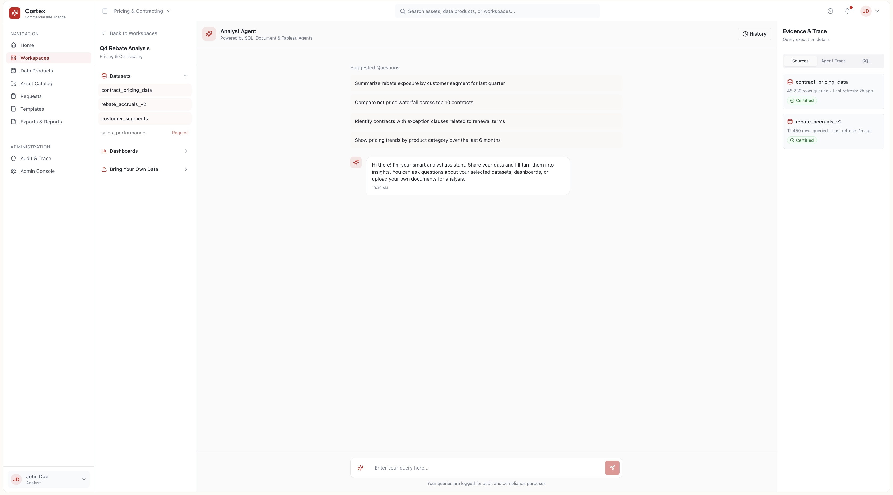
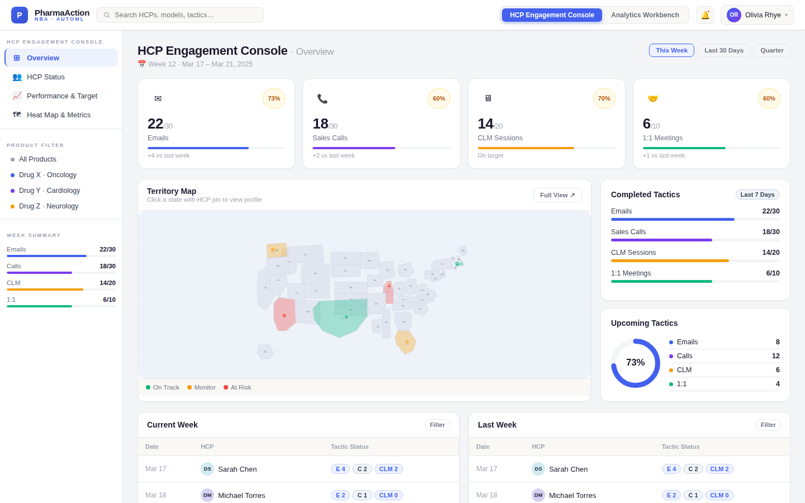

# Life Sciences Product Concepts

Four product concepts for pharma and biotech commercial teams. Each one starts from a real workflow problem in pharma commercial operations and goes from problem statement to product requirements to a clickable prototype.

| Concept | The problem it solves | Who uses it | What's in the folder | Live prototype |
|---|---|---|---|---|
| [**Cortex**](cortex/) | Commercial analysts spend more time finding and validating data than analysing it | Pricing, contracting, market access and brand analytics teams | Concept doc, PRD, 13 screens, React app | [Open](https://data-sense-forge-87.lovable.app) |
| [**Pharma Action Builder**](pharma-action-builder/) | Data science models rarely reach field reps in a form they can act on | Field reps, commercial analytics, commercial excellence | Concept doc, PRD, 17 screens, HTML prototype | [Open](https://pharma-action-builder.netlify.app/) |
| [**ClearAuth**](clearauth/) | Prior authorization delays therapy starts and burns provider time | Providers, patients, payers | Concept doc, PRD, process flow, 19 screens, full-stack app | [Open](https://pharma-pa-ra-hub--gnanaramm.replit.app/) |
| [**GVD Process Map**](gvd/) | Building a Global Value Dossier involves a dozen teams and no single view of the process | Market access, HEOR, medical affairs | Interactive process map | [Open](https://gvd-processflow.netlify.app/) |

<p>
  
  
  
  
</p>

## Terms used in this repo

- **HCP**: healthcare professional, usually the prescribing physician a pharma company engages with.
- **NBA (Next Best Action)**: a recommendation for the single most useful next interaction with an HCP, such as an email, a rep visit or a webinar invite, chosen by a model.
- **Prior authorization (PA)**: an insurer's requirement that a doctor get approval before a drug is covered. **Re-authorization** is the renewal of that approval.
- **Payer**: the insurer or pharmacy benefit manager that pays for the drug.
- **GVD (Global Value Dossier)**: the master evidence document a manufacturer builds to prove a drug's clinical and economic value to payers and health technology assessment (HTA) bodies in each country.
- **PRD (Product Requirements Document)**: the spec that defines what a product must do, for whom, and how success is measured.

## How each concept folder is organised

```
<concept>/
├── README.md     problem, users, features, status
├── docs/         concept document and PRD (.md to read on GitHub, .docx originals)
├── screens/      UI screenshots
└── app/ or prototype/   source code for the prototype
```

## Status and honesty notes

- All four are **concept-stage prototypes**. They run on mock data and are not connected to real CRM, claims or payer systems.
- Impact figures in the concept documents (for example "40–60% reduction in data discovery time") are **target hypotheses** to be tested in a pilot, not measured results.
- Prototypes were built with AI-assisted development tools (Lovable, Replit) from the requirements I wrote. The product thinking, workflows and requirements are mine.

## About me

I'm Gnanaram M, a solutions consultant working on commercial and market access problems for US pharma and biotech. See my [GitHub profile](https://github.com/Gnanaram23) for analytics projects, or connect on [LinkedIn](https://linkedin.com/in/gnanaram/).
