# ClearAuth: Prior Authorization and Re-Authorization Platform

ClearAuth puts the provider, the patient and the payer on one shared view of a prior authorization case, with AI help at the points where cases usually stall: incomplete documentation, unclear status, and slow clinical review.

**[Open the live prototype](https://gnanaram23.github.io/Product-Concepts---Commercial-/clearauth/)** (runs in your browser) · [Replit deployment](https://pharma-pa-ra-hub--gnanaramm.replit.app/) · [Concept document](docs/clearauth-concept.md) · [PRD](docs/clearauth-prd.md)

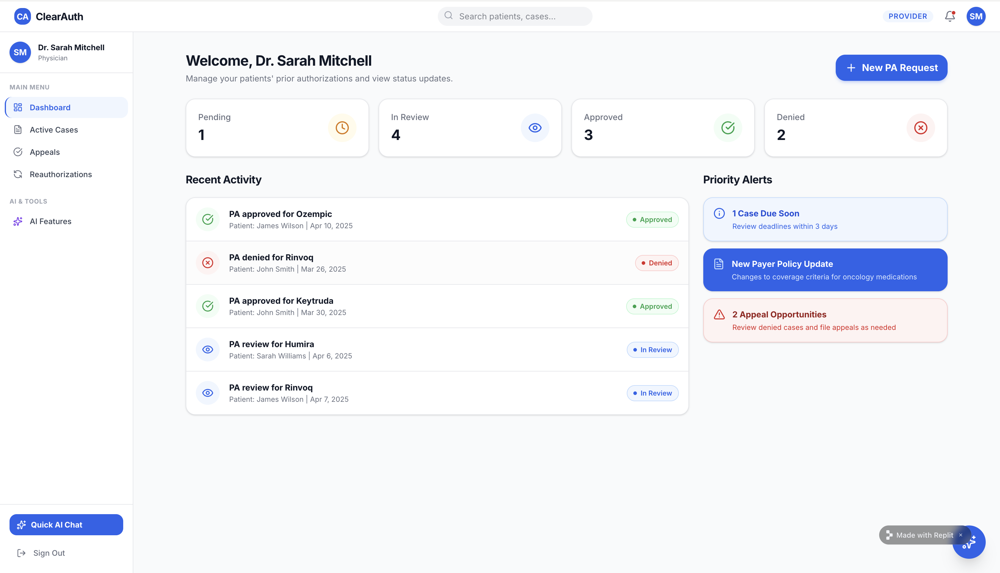

## The problem

Prior authorization (PA) is an insurer's requirement that a doctor get approval before a drug or procedure is covered. Re-authorization (RA) renews that approval, often every 6 to 12 months for specialty drugs. The [AMA's 2024 survey of 1,000 physicians](https://www.azmed.org/news/694951/AMA-Releases-its-2024-Prior-Authorization-Physician-Survey-.htm) found:

- 94% say prior authorization delays necessary care
- 82% say it can lead patients to abandon treatment
- practices handle about 43 PA requests per physician each week, taking about 12 hours of physician and staff time

Each stakeholder feels a different version of this:

| Stakeholder | Pain point | Result |
|---|---|---|
| Provider | Forms completed by hand over fax or portal, with frequent requests for missing information | Staff time lost, delayed therapy starts |
| Patient | No visibility into status; often learns of a denial at the pharmacy counter | Abandoned prescriptions |
| Payer | Incomplete submissions trigger repeated back-and-forth before review | Higher cost per decision, slower turnaround |

## How a case flows

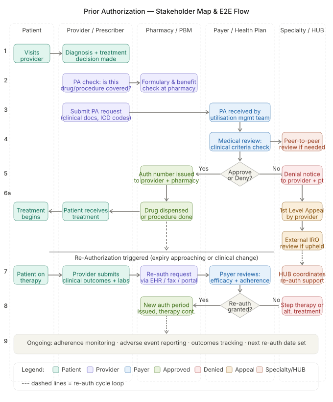

## Features by role

**Provider**
- New PA request: patient lookup, ICD-10 diagnosis code suggestions, clinical justification, document upload, choice of submission channel (HL7 FHIR, portal or fax)
- Active cases table with view, appeal and share actions
- Appeal letters drafted from the case record
- Re-authorization alerts 45 days before an approval expires, ranked by urgency
- AI assistant: form help, document completeness check, and approval-likelihood insights

**Patient**
- Six-step journey tracker (Submitted → Received → Clinical review → Decision pending → Decision → Treatment starts) with a plain-language explanation of each step
- Document upload, with a prompt when supporting evidence is missing
- AI assistant that explains the treatment, the case status and common side effects in plain language

**Payer**
- Review queue with approve, deny and AI review actions, plus workload metrics
- AI clinical review: which coverage criteria are met or unmet, suggested alternatives, and an appropriateness summary

**Platform-wide:** a role-aware assistant, a case timeline of every event, notifications on status changes, and an audit trail of decisions.

**Terms:** ICD-10 is the standard diagnosis coding system. HL7 FHIR is the healthcare data-exchange standard behind CMS's 2024 interoperability rule, which requires many payers to offer FHIR-based prior authorization APIs from January 2027. That rule left drugs out; in April 2026 CMS [proposed extending it to drugs](https://college.acaai.org/cms-proposes-expanding-prior-authorization-regulations-to-drugs/) with 24-hour (urgent) and 72-hour (standard) decision deadlines, which makes a tool like ClearAuth more timely.

## Screens

| | |
|---|---|
| 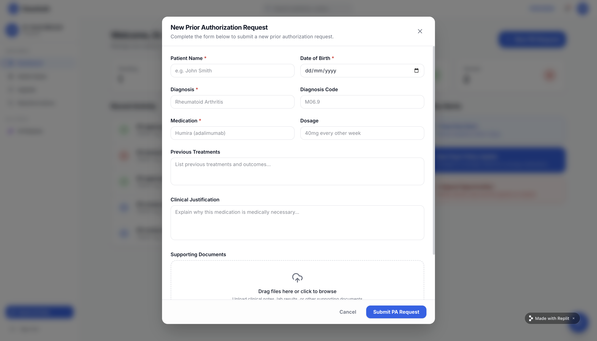 Provider: new PA request | 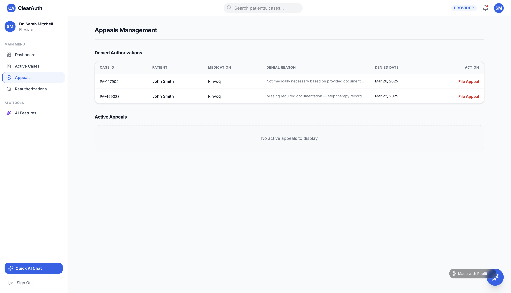 Provider: appeals |
| 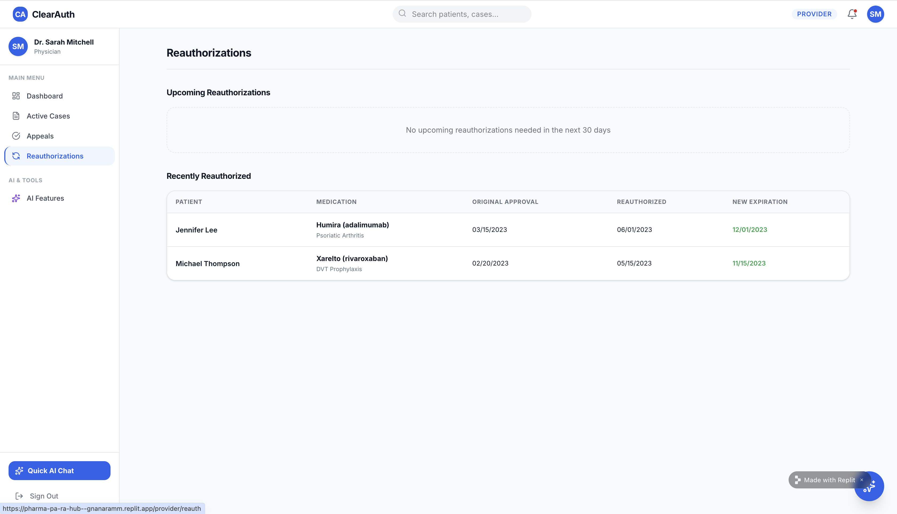 Provider: re-authorization window | 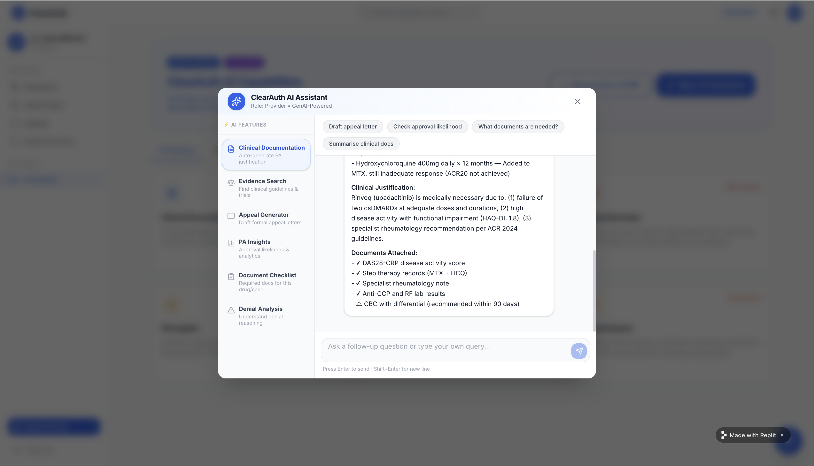 Provider: AI assistant |
| 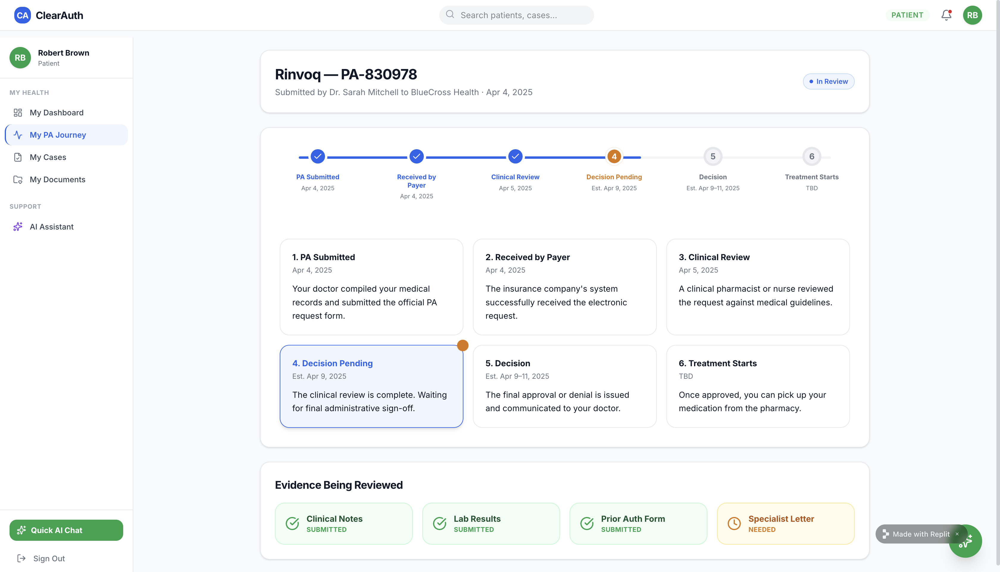 Patient: journey tracker | 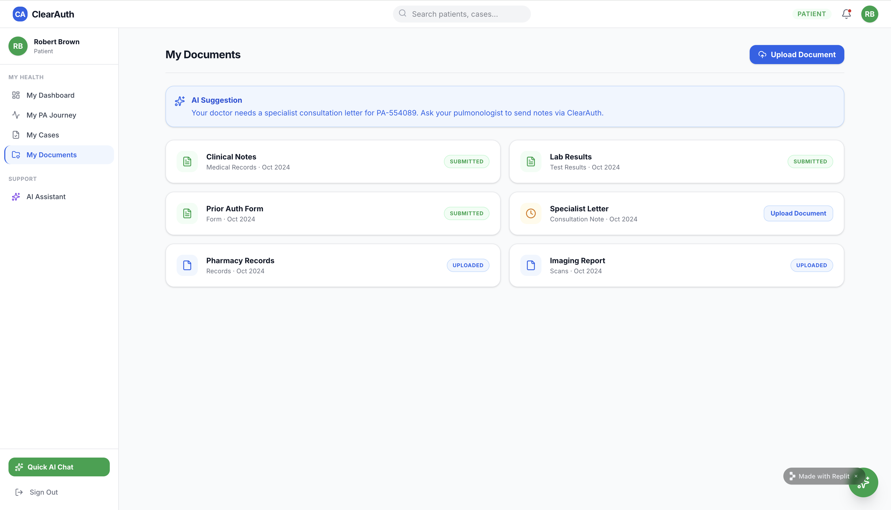 Patient: documents |
| 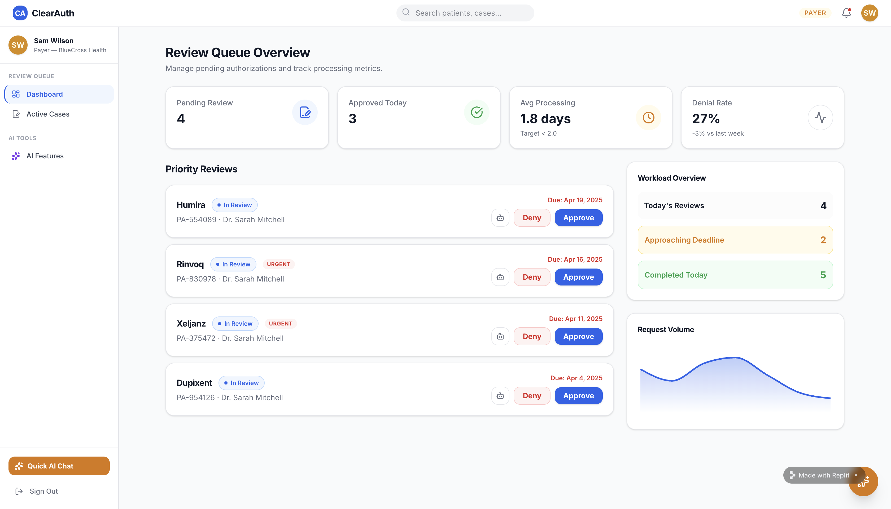 Payer: review queue | 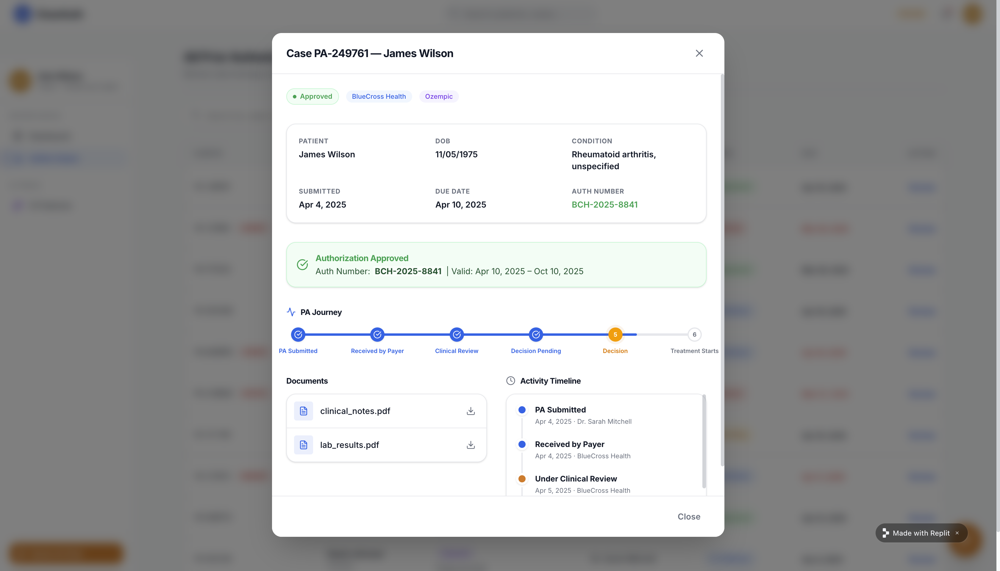 Payer: case details |

Demo users: Dr. Sarah Mitchell (provider), James Wilson (patient), Sam Wilson (payer). All names and cases are fictional.

## What's built

| Layer | Technology |
|---|---|
| Front end | React 18, TypeScript, Vite, Tailwind, shadcn/ui |
| API | Express 5 and TypeScript, with an OpenAPI 3.1 spec and generated Zod validators and React Query hooks (Orval) |
| Domain logic | `lib/core`: data store, policy engine, assistant and one framework-free API handler, shared by the server and the in-browser demo |
| Data | In-memory store with seeded demo cases (a Drizzle/PostgreSQL schema is scaffolded for later) |
| Monorepo | pnpm workspaces |

### The coverage-policy engine and assistant

A rules engine ([`app/lib/core/src/policies.ts`](app/lib/core/src/policies.ts)) holds coverage criteria for Humira, Rinvoq, Skyrizi, Dupixent, Ozempic, Mounjaro and Keytruda across their main indications. The criteria cover the on-label ICD-10 diagnosis, step therapy, severity, TB screening and required documents. Every case is checked field by field. For each criterion the result shows met, not met or unclear, the evidence used and how to close the gap. It also gives a 0–100 policy fit score and a recommendation.

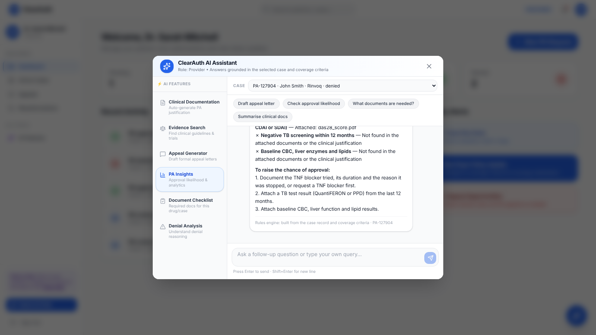

The assistant builds every answer from the selected case, the policy result and a drug reference table. That covers approval outlook, document checklists, letters of medical necessity, appeal and determination drafts, side effects in plain language, formulary alternatives and queue triage. If an LLM is configured, which can be any OpenAI-compatible endpoint including a free local Ollama model, it rewrites the grounded answer for the user's question. If the LLM fails, the rules-engine answer is shown instead. The policies are illustrative, modelled on how US plans write criteria, and are not any real payer's policy.

### API endpoints

| Method | Path | Purpose |
|---|---|---|
| GET | `/api/healthz` | Health check |
| GET / POST | `/api/cases` | List or create PA cases |
| GET / PATCH | `/api/cases/:id` | Read or update a case |
| POST | `/api/cases/:id/submit` | Submit a case to the payer |
| POST | `/api/cases/:id/appeal` | File an appeal |
| GET | `/api/patients`, `/api/patients/:id` | Patient records |
| GET | `/api/reauth` | Cases approaching re-authorization |
| GET | `/api/cases/:id/policy` | Coverage-policy evaluation |
| GET | `/api/meta` | Server or demo mode, and whether an LLM is configured |
| POST | `/api/ai` | Role-aware assistant grounded in a case (`caseId`) |

### Run it locally

Requires Node.js 20+ and pnpm (`corepack enable`).

```bash
cd app
pnpm install
pnpm run dev:api     # API on :8080
pnpm run dev:web     # web app on :5173
```

With no API running, the web app switches to **demo mode** by itself: the same API code runs in the browser and saves changes to local storage. That is how it runs on GitHub Pages, Netlify and Vercel. For the full server, use `docker build -t clearauth app && docker run -p 8080:8080 clearauth`, or the Render blueprint. See [DEPLOY.md](../DEPLOY.md).

## Roadmap

1. Retrieval over real payer policy documents to replace the illustrative criteria
2. Real FHIR-based submission against a payer sandbox
3. PostgreSQL persistence and role-based authentication
4. Payer analytics: denial reasons, turnaround time, first-pass approval rate

## Target impact (hypotheses to test in a pilot)

- 65% less provider administrative time per PA
- 35% higher first-pass approval rate through complete documentation
- Real-time case visibility for patients

These are design targets, not measured results.
