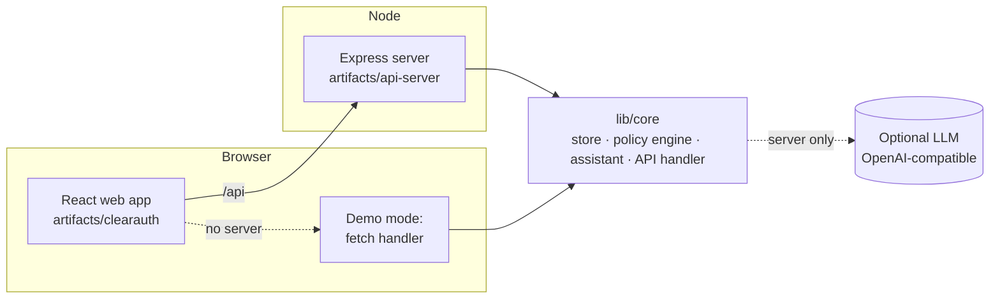

# ClearAuth

ClearAuth is a prior authorization (PA) platform with three views: the
**provider** who requests a drug, the **patient** waiting for it, and the
**payer** who reviews it. A coverage-policy engine checks every request
against the plan's criteria, and an assistant explains the result to each of
the three users.

It runs with no setup. Without a server, the API runs inside the browser
(demo mode). With a server, the same API code runs in Node. An LLM is
optional.

## What it does

| View | What you can do |
|---|---|
| Provider | Submit PA requests, track status, see which coverage criteria are met, draft letters of medical necessity and appeals |
| Patient | Follow the request in plain language, see side effects to watch for and appeal rights |
| Payer | Work the review queue, match each case to coverage criteria, find formulary alternatives, draft determination notices |

### The coverage-policy engine

[`lib/core/src/policies.ts`](lib/core/src/policies.ts) holds criteria for
Humira, Rinvoq, Skyrizi, Dupixent, Ozempic, Mounjaro and Keytruda across
their main indications. The criteria cover the on-label diagnosis (ICD-10),
step therapy, severity, TB screening and required documents. Each case is
checked field by field. The result lists every criterion as met, not met or
unclear, with the evidence it used and how to fix any gap. It also gives a
0–100 policy fit score and a recommendation: approve, request information, or
send to a medical director.

For example, case PA-127904 asks for Rinvoq for rheumatoid arthritis after
methotrexate and hydroxychloroquine. The engine flags that the Rinvoq label
requires a prior TNF blocker, that the TB screening is missing and that
baseline labs are missing. This matches the plan's denial reason, and the
appeal draft is built from those gaps.

The policies are illustrative. They are modelled on how US plans write
criteria, not taken from any real payer.

### The assistant

Every answer is built from the selected case, the policy evaluation and a
drug reference table (class, side effects, boxed warnings, pivotal trials,
formulary alternatives), so the answer changes when the case changes. If you
configure an LLM, it rewrites the grounded answer for the user's question. The
model receives only that case and is told not to add facts. If the LLM call
fails, the rules-engine answer is returned instead. Each reply shows which
of the two produced it.

## Run it

**Requirements:** Node 20 or later, pnpm 10 (`corepack enable`).

```bash
pnpm install
pnpm run dev:api     # API on http://localhost:8080
pnpm run dev:web     # web app on http://localhost:5173 (proxies /api to 8080)
```

To run only the web app, use `pnpm run dev:web`. With no API reachable, it
switches to demo mode by itself.

To build both and run them as one server:

```bash
pnpm run build:app && pnpm start    # http://localhost:8080
```

## Deploy

| Option | Command or step | What you get |
|---|---|---|
| **Docker** | `docker build -t clearauth . && docker run -p 8080:8080 clearauth` | Full app: API and web in one container |
| **Docker Compose + local LLM** | `docker compose --profile llm up`, then `docker compose exec ollama ollama pull llama3.2` and set `LLM_BASE_URL=http://ollama:11434/v1`, `LLM_MODEL=llama3.2` | Full app with a free local model |
| **Render** | New > Blueprint > this repo (uses `render.yaml`) | Hosted full app on the free plan |
| **Netlify / Vercel** | Import the repo; `netlify.toml` / `vercel.json` are included | Static site in demo mode |
| **GitHub Pages** | Settings > Pages > Source: GitHub Actions (public repos) | Static site in demo mode, rebuilt on every push |

In demo mode, data is saved in the visitor's browser (localStorage) and can be
reset from the sidebar.

### LLM settings (optional)

These variables are read by the server. Any OpenAI-compatible endpoint works.
See [`.env.example`](.env.example).

| Variable | Example |
|---|---|
| `LLM_API_KEY` | `sk-...` (OpenAI is the default endpoint when only a key is set) |
| `LLM_BASE_URL` | `https://api.groq.com/openai/v1`, `http://localhost:11434/v1` (Ollama) |
| `LLM_MODEL` | `gpt-4o-mini` (default), `llama-3.3-70b-versatile`, `llama3.2` |

Keys stay on the server. The static demo never calls an LLM.

## API

| Method and path | Purpose |
|---|---|
| `GET /api/healthz` | Health check |
| `GET /api/meta` | Mode (`server` or `demo`) and whether an LLM is configured |
| `GET /api/cases?status=&payer=` | List cases |
| `POST /api/cases` | Create a PA request |
| `GET /api/cases/:id` | One case with its timeline |
| `PATCH /api/cases/:id` | Approve, deny (needs `denialReason`) or move to review |
| `POST /api/cases/:id/submit` | Send to the payer |
| `POST /api/cases/:id/appeal` | File an appeal |
| `GET /api/cases/:id/policy` | Coverage-policy evaluation |
| `GET /api/patients`, `GET /api/patients/:id` | Patients |
| `GET /api/reauth` | Upcoming reauthorizations |
| `POST /api/ai` | Assistant: `{ role, message, feature?, caseId? }` |

The OpenAPI spec is in [`lib/api-spec/openapi.yaml`](lib/api-spec/openapi.yaml).

## How it is built



```
artifacts/
  clearauth/        React + Vite + Tailwind web app (wouter, TanStack Query)
  api-server/       Express 5 server: mounts the core API and serves the web build
lib/
  core/             Domain logic shared by server and browser
  api-spec/         OpenAPI spec (Orval codegen config)
  api-client-react/ Generated React Query hooks
  api-zod/          Generated Zod schemas
```

The data store is in memory and resets when the server restarts. To make it
persistent, replace the functions in
[`lib/core/src/store.ts`](lib/core/src/store.ts) with a database (a Drizzle
setup is in `lib/db`).

## Disclaimer

This is a product prototype with synthetic patients. It is not a medical
device and does not give medical advice. Coverage criteria and drug summaries
are simplified from public prescribing information for illustration.
