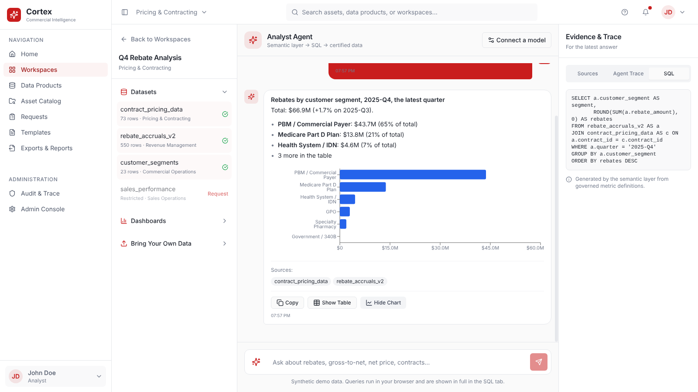
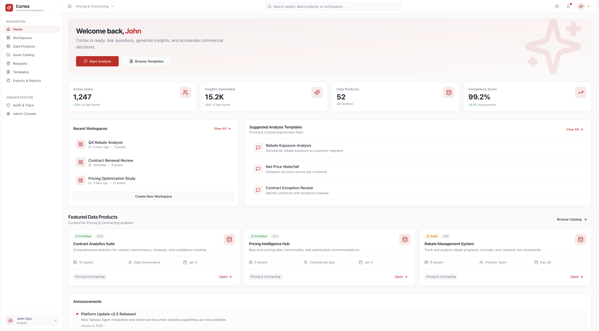
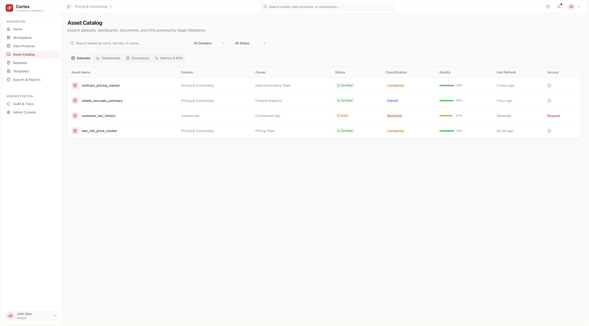
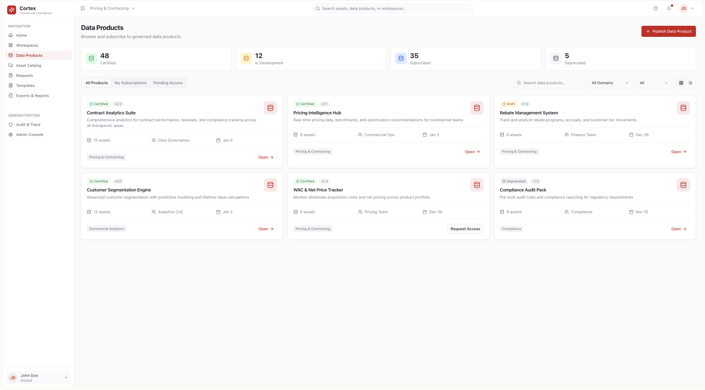
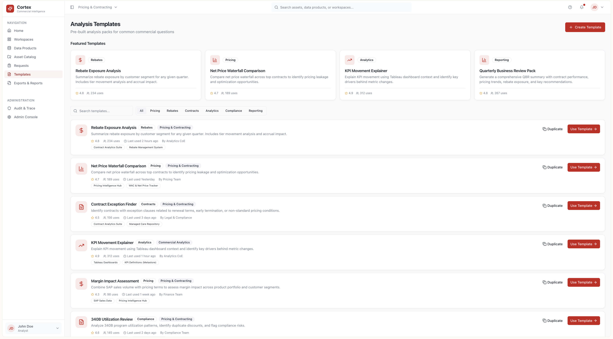
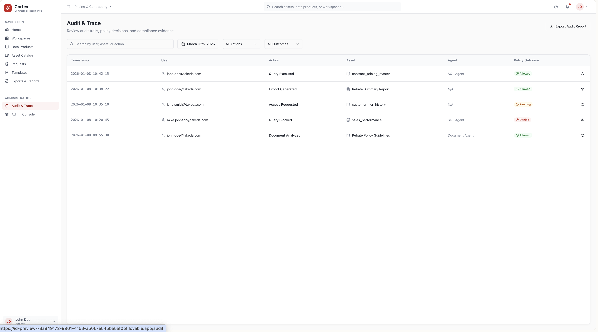
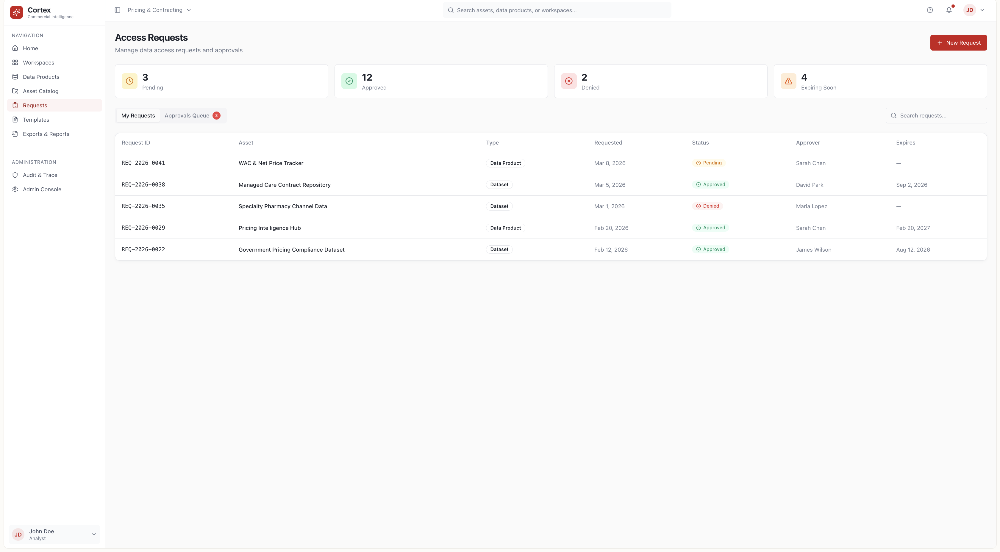
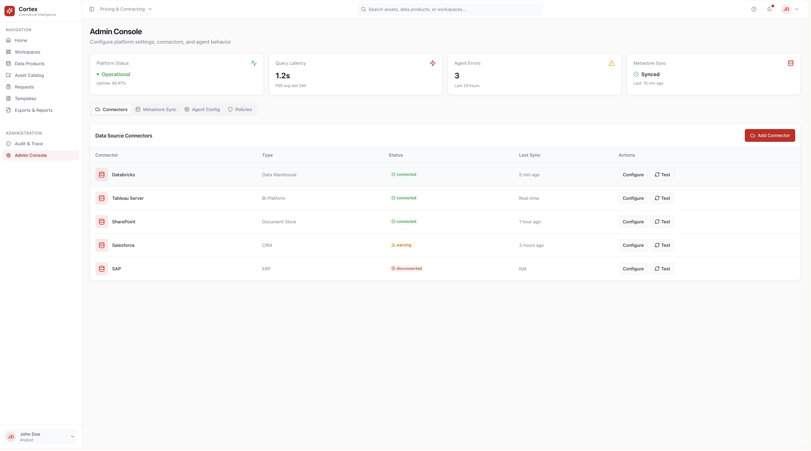
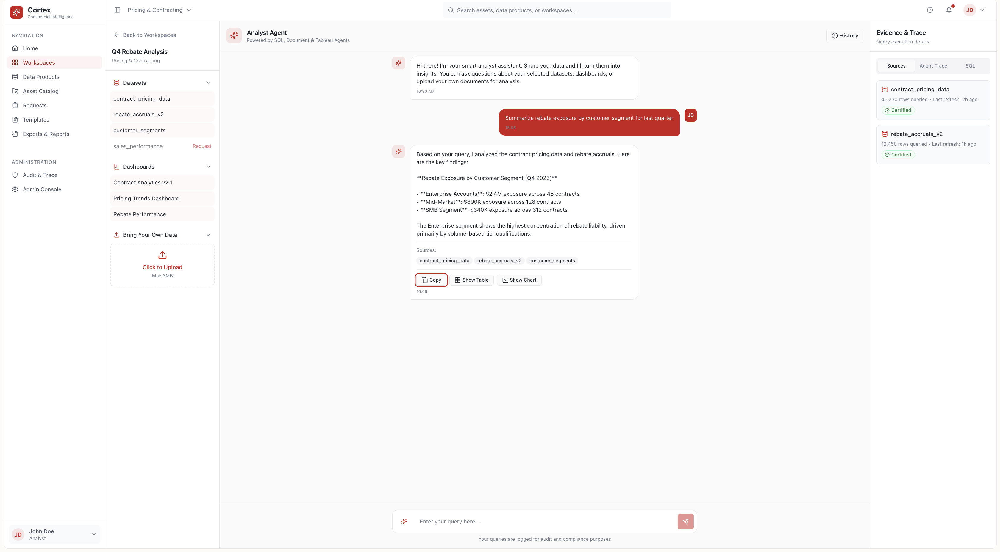
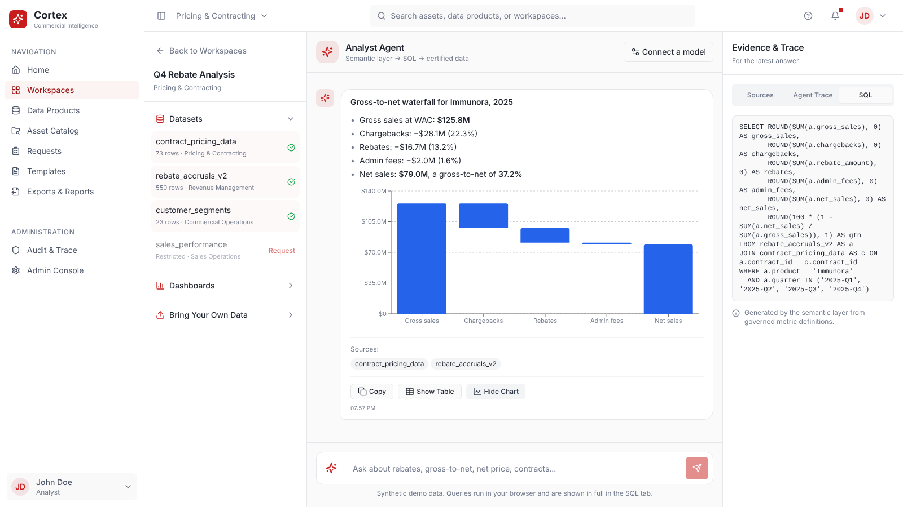

# Cortex: AI Assistant for Commercial Analytics

Cortex turns a business question ("What drove rebate variance last quarter?") into a governed, explainable answer drawn from a company's commercial data, without the user writing SQL or hunting through dashboards.

**[Open the analyst workspace](https://gnanaram23.github.io/Product-Concepts---Commercial-/cortex/workspaces/1)** · [Lovable deployment](https://data-sense-forge-87.lovable.app) · [Concept document](docs/cortex-concept.md) · [PRD](docs/cortex-prd.md)



## The problem

A pharma commercial team's data is spread across pricing systems, contracts, claims, CRM, BI dashboards and documents. Even when the data exists, analysts struggle with the same things:

- finding the right dataset or dashboard for a question
- KPI definitions that differ from team to team (two "net price" numbers in one meeting)
- slow, manual validation before anyone trusts a number
- waiting on the data or BI team for every ad-hoc question
- distrust of AI answers that can't show where a number came from

## Who it's for

Pricing and contracting analysts, market access teams, commercial operations, brand and sales analytics, data and analytics leaders, and data stewards (the people responsible for data quality and definitions).

## How it works

```
Question → Intent understanding → Metadata discovery → Access check → Query execution → Insight → Explanation
```

The design is **metadata-first**. Before any model writes a query, Cortex looks up what each dataset means, who owns it, how KPIs are defined and who is allowed to see it. That catalogue is called the *Magic Meta Store*. Answers are generated by deterministic SQL against approved sources, so every number can be traced back to its table and logic.

Planned agent roles:

| Agent | Job |
|---|---|
| Supervisor | Reads the question, works out intent, routes the work |
| SQL agent | Writes and runs queries against structured data |
| Document agent | Answers questions from PDFs, Excel and CSV files |
| Dashboard agent | Explains existing BI dashboards using their lineage |
| Goalkeeper agent | Enforces access rules and governance before anything runs |

## Example questions

- What drove rebate variance last quarter?
- Which contracts are underperforming against their target?
- How did payer coverage change across regions?
- What explains the drop in net price for product X?
- Which datasets should I use for a market access analysis?

## Screens

| | |
|---|---|
|  Home |  Asset catalog |
|  Data products |  Analysis templates |
|  Audit and trace |  Access requests |
|  Admin console |  Analyst workspace |

## MVP scope

Natural-language questions, metadata-driven asset discovery, SQL generation and execution, explainable outputs, document Q&A, and access-aware validation.

**Later:** a knowledge graph of commercial concepts, cross-domain reasoning, proactive insight alerts, and scenario simulation for pricing and contracting decisions.

## Target impact (hypotheses to test in a pilot)

| Metric | Target |
|---|---|
| Time spent finding data | 40–60% lower |
| Time from question to insight | 30–50% faster |
| Duplicate KPI definitions | 25–40% fewer |
| Answers with traceable source and logic | 100% |

These are design targets, not measured results.

## What works in the prototype

The analyst workspace answers questions from real queries:

- **Semantic layer.** Governed definitions of gross sales, net sales, rebates, chargebacks, admin fees, units, gross-to-net % and net price per unit. They can be broken down by segment, product, category, region, customer, contract or quarter, over any period in the data. A question becomes a plan, then SQL ([`app/src/engine/semantic.ts`](app/src/engine/semantic.ts)).
- **Query execution in the browser.** AlaSQL runs over a seeded synthetic contracting dataset: 23 customers across PBMs, Part D plans, GPOs, health systems, specialty pharmacies and 340B; six fictional brands; and quarterly gross-to-net from 2024 to 2025.
- **Answers that can be traced.** Each reply has a summary computed from the result, plus a table, a chart (bar, trend or gross-to-net waterfall), the datasets used, the agent steps with timings, and the exact SQL.
- **Governance.** Restricted datasets are blocked before anything runs, and the user is offered an access request. Uploaded CSVs become uncertified tables.
- **Optional LLM.** Connect any OpenAI-compatible model, or a local Ollama server, to handle free-form questions. Its SQL is checked to be a single read-only `SELECT` on permitted tables before it runs.



The other screens are clickable designs with sample content.

### Run it

```bash
cd app
npm ci
npm run dev        # http://localhost:8080
```

To host it, see [DEPLOY.md](../DEPLOY.md). It is a static site: GitHub Pages, Netlify, Vercel or Docker all work.

Cortex is a decision-support tool. It speeds up analysis; it does not replace the analyst's judgment.
