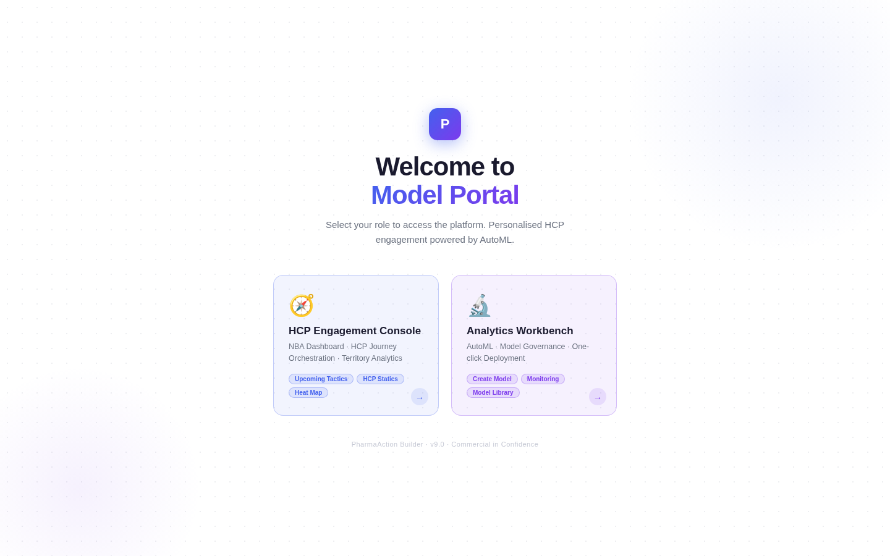
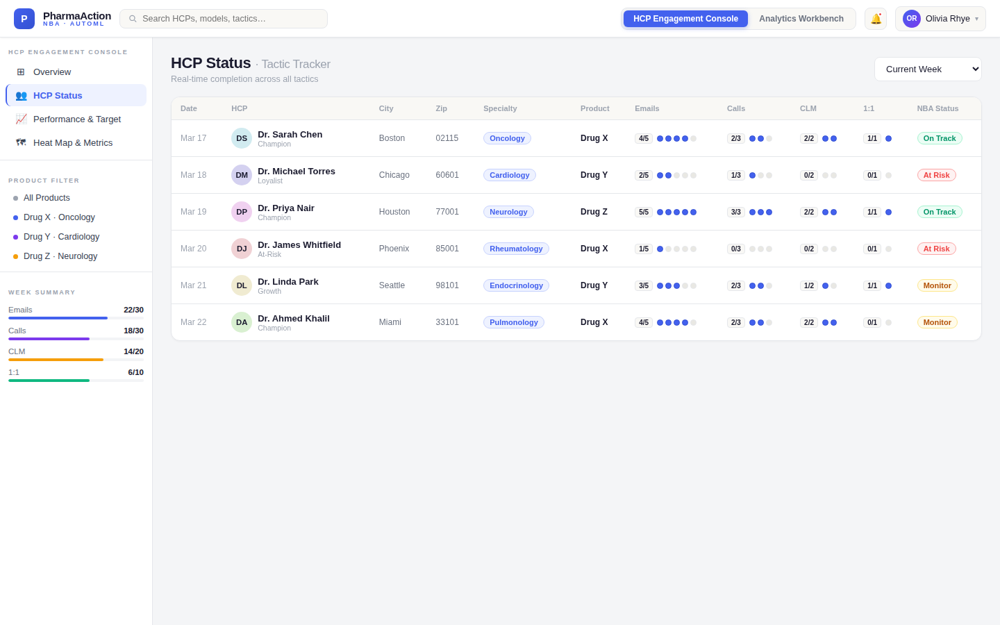
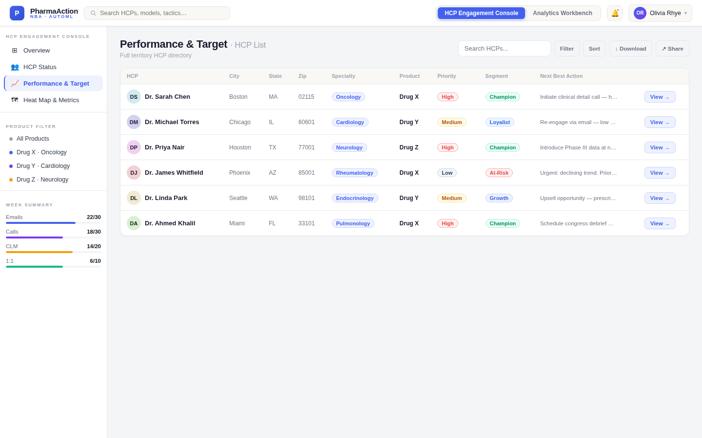
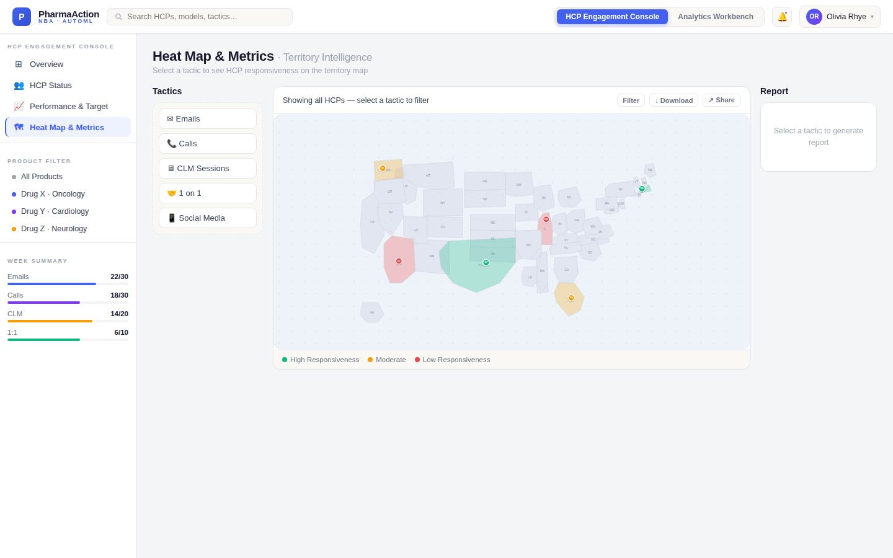
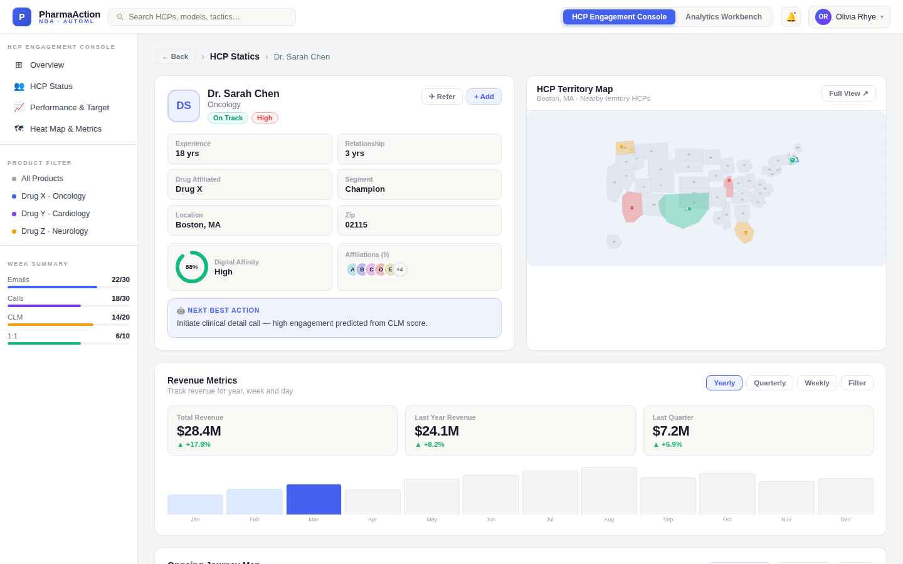
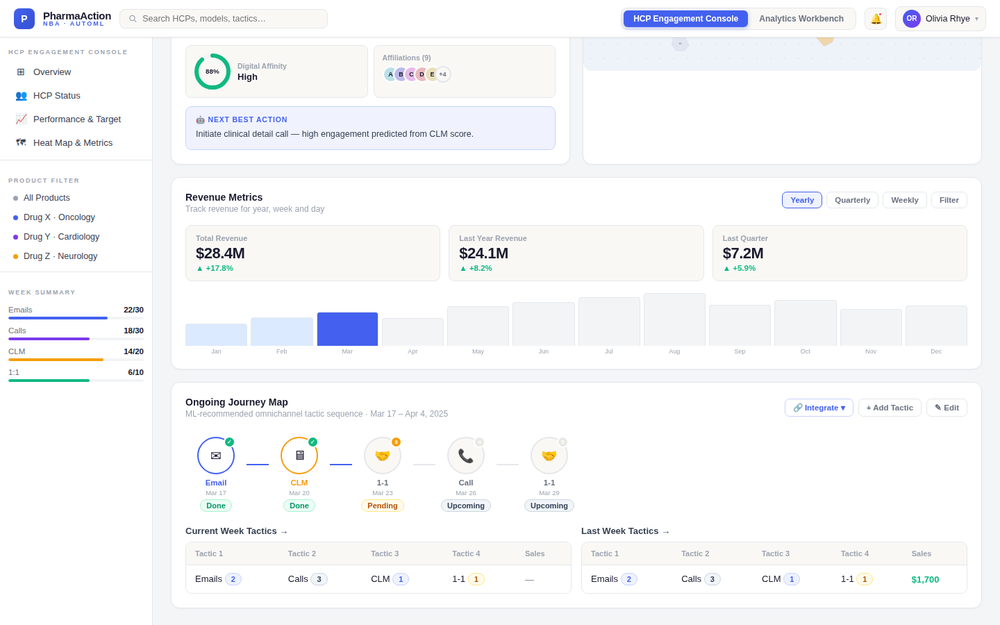
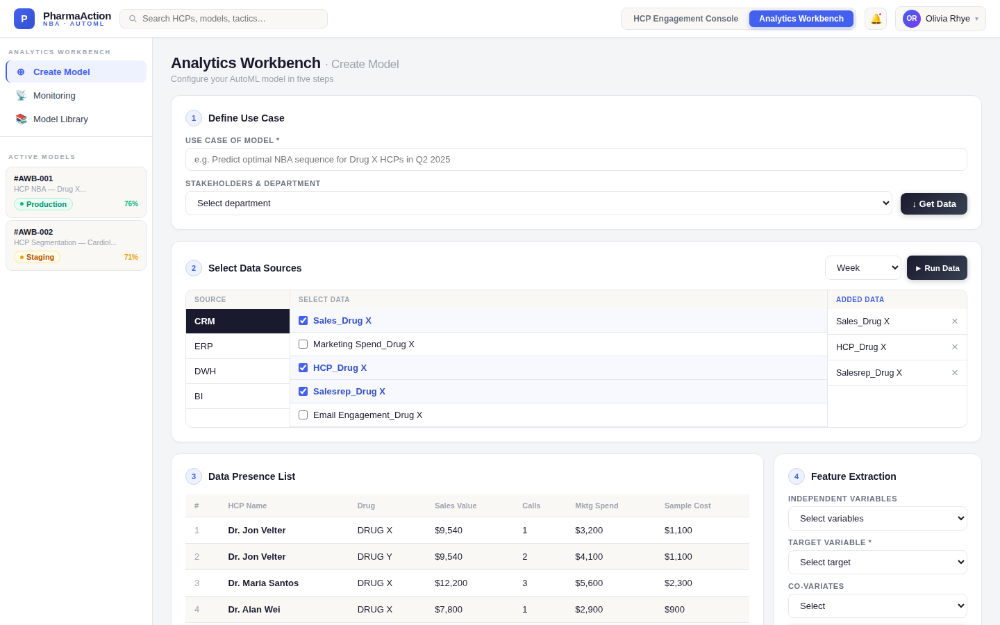
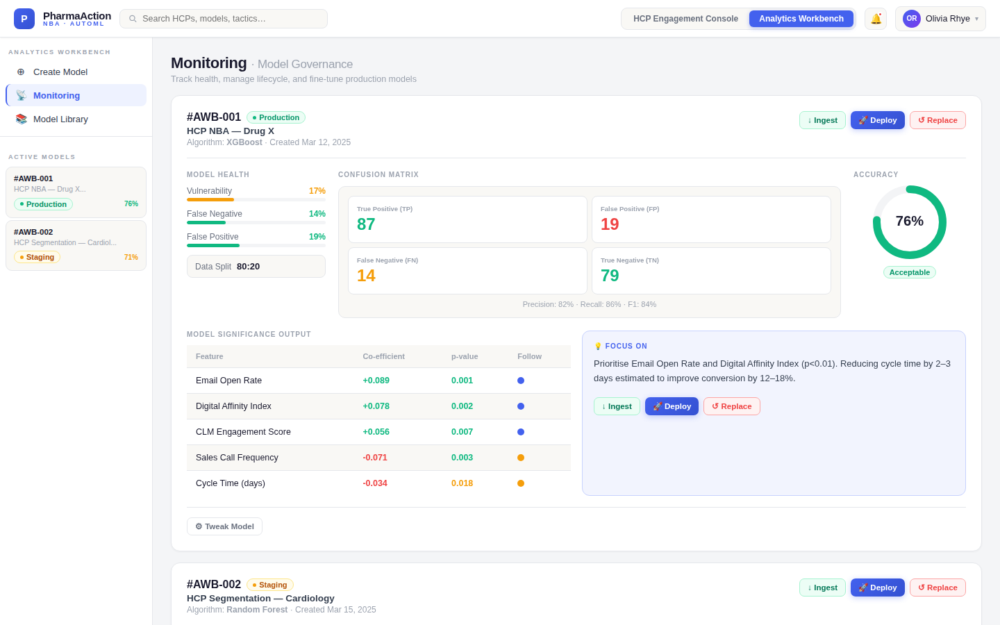

# Pharma Action Builder: Next Best Action for HCP Engagement

Pharma Action Builder connects the models a commercial analytics team builds to the field rep who has to act on them. Each rep gets a personalised weekly plan for every HCP (healthcare professional) on their list: which channel to use, when, and why. Analytics teams build, monitor and deploy the models behind those plans without writing code.

**[Open the live prototype](https://pharma-action-builder.netlify.app/)** · [Concept document](docs/action-builder-concept.md) · [PRD](docs/action-builder-prd.md)

## The problem

Most pharma companies already have propensity models: models that score how likely an HCP is to respond to an email, a rep visit or a speaker programme. Few of those scores reach the field in usable form. They arrive as spreadsheets weeks after the model was built, so reps fall back on generic call plans. HCPs end up over-contacted with irrelevant outreach and under-served with useful information. Field outcomes also never feed back into the models.

## The two modules

**HCP Engagement Console (HEC)**, for the field:
- weekly NBA (Next Best Action) journey plan per HCP
- tactic tracking across email, calls, CLM sessions and 1:1 meetings (CLM, closed-loop marketing, is the tablet-based detailing a rep shows an HCP, with engagement captured back into the CRM)
- HCP-level performance against target
- territory heat maps showing where HCPs are responsive and where they aren't

**Analytics Workbench (AWB)**, for analytics teams:
- no-code AutoML: pick a data source (CRM, ERP, data warehouse), choose a target, train
- model monitoring for drift and accuracy
- a model library with governance and one-click deployment to the HEC

Together they make a closed loop: the model recommends, the rep acts, the outcome is captured, and the model retrains.

## Who it's for

Field representatives, commercial analytics and data science teams, commercial excellence leaders, and marketing operations and brand teams.

## Screens

| | |
|---|---|
|  Portal landing |  HCP status |
|  Performance vs target |  Territory heat map |
|  HCP profile |  HCP journey map |
|  AutoML: create model |  Model monitoring |

All HCP names and figures in the screens are fictional.

## Prototype

[`prototype/index.html`](prototype/index.html) is a single-file, front-end prototype with mock data. Open it in any browser; there's nothing to install.

## Status

Concept v2.0. The prototype shows the target experience; the AutoML engine, CRM integration and feedback loop are specified in the [PRD](docs/action-builder-prd.md) but not built.
